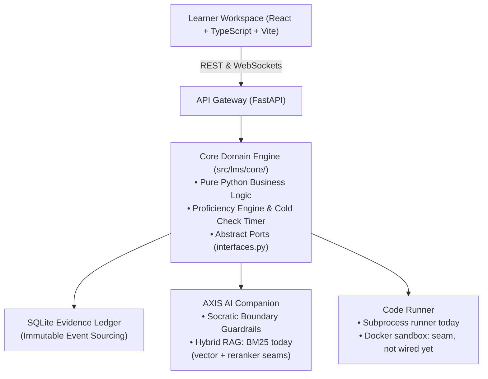

# Aethelgard Academy™
### Autonomous Curriculum Studio & Socratic AI Engineering Platform

> Architected by **Asheesh Ranjan Srivastava** ([@AsheeshSrivastava](https://github.com/AsheeshSrivastava))  
> Licensed under **Business Source License (BSL 1.1)** — see [`LICENSE`](LICENSE)  
> Architectural Deep-Dive: [`ARCHITECTURE.md`](ARCHITECTURE.md)

---

## The Origin & Purpose

> *"I built Aethelgard Academy first and foremost for myself.*  
> *When transitioning into technical engineering, I quickly realized I could make AI generate code, but I could not yet confidently decide whether to trust or change it. I was picking up fragmented syntax without grasping how real systems connect, and unconstrained AI chatbots only made it worse by handing out direct solutions.*  
> *I needed an environment that offered small, realistic review-and-repair tasks, taught only the missing mental models, and verified whether I could handle new versions later without AI handholding. The goal is to show what the learner can actually do—with their help and limits made crystal clear."*  
> — **Asheesh Ranjan Srivastava**, Systems Architect

---

## What the System Does

Aethelgard Academy bridges the gap between **"vibe coding with AI"** and **"production-grade systems engineering"**.

1. **Cumulative Project Spine:** Replaces isolated toy puzzles (`foo()` / `bar()`) with continuous operational workflows (Ingress $\to$ Transformation $\to$ Egress) inspired by real-world triage, intake, and multi-agent pipelines.
2. **Socratic AI Companion (AXIS):** An AI mentor with three modes (Coach, Hybrid, Socratic). In Socratic mode, which builds use, its output is filtered so it never hands over a code solution; Cold Checks run without AXIS at all. This keeps the "productive struggle" that builds diagnostic composure and debugging instincts.
3. **Deterministic Capability Tracking:** Replaces vanity completion percentages (`completed = true`) with an **immutable, append-only Evidence Ledger**. True mastery is calculated by analyzing historical attempts, assistance levels, and 24-hour Cold Check retention tests.

---

## High-Level Architecture (Hexagonal / Ports & Adapters)

To guarantee that the platform remains modular, decoupled, and testable offline with zero API key dependencies, the system follows a strict **Hexagonal Architecture**:



### Architectural Highlights
- **Zero-Dependency Domain Core:** `src/lms/core/` does not import FastAPI, SQLite, Docker, or AI libraries. All business rules and capability logic can be verified in milliseconds offline.
- **Assistance Accounting:** Distinguishes between syntax lookups (`SYNTAX_LOOKUP`, encouraged developer practice) and algorithmic shortcuts (`SUPPLIED_REASONING`). If AI supplies the reasoning path, the skill is routed to targeted unassisted practice (`STRENGTHEN`).
- **Verified Retrieval (RAG):** An inverted BM25 index (exact keywords, flags and function names) with heading-aware chunking. Every retrieved passage is checked to be an exact byte-slice of its source (`verify_passage == True`). Reciprocal Rank Fusion ($k=60$) and a reranker slot are built in, but no embedding model or cross-encoder is wired yet, so ranking today is lexical.
- **Code Runner:** Learner code runs in a subprocess with a timeout, in a temporary folder, with API keys and `.env` secrets stripped from its environment. A `DockerRunner` that builds a network-disabled, memory-, CPU- and process-limited container command exists, but it is not wired in yet: today it falls back to the subprocess runner. Until it is, the app is for single-learner local use, not for running strangers' code.

### Built Today vs Pluggable Seams

| Area | Built and tested today | Seam ready, not wired yet |
| :--- | :--- | :--- |
| Persistence | SQLite append-only evidence ledger, idempotent attempts, non-destructive resets | PostgreSQL adapter behind `ILearnerRepository` |
| Code execution | Subprocess runner: timeout, temp folder, secrets stripped | Docker sandbox (`--network none`, memory, CPU and process limits) behind `ICodeRunner` |
| Retrieval | BM25 index, exact byte-slice verification, RRF fusion code | Dense embeddings and a cross-encoder reranker |
| AXIS grounding | Upstream-docs index when built locally (`data/index`, not in git; ADR-0003 temporary exception) | Curriculum concept notes as the retrieval source (ADR-0003 target) |
| AI providers | Offline mock, local OpenAI-compatible model, OpenAI, Gemini, monthly cost cap | Any other provider behind `IAXISCompanion` |

---

## Quickstart (Run Locally in Under 1 Minute)

The platform is designed to run **100% offline with zero external API keys or cloud accounts** via built-in deterministic mock adapters (`MOCK_AI=true`).

### Prerequisites
- Python 3.14
- [`uv`](https://github.com/astral-sh/uv) (fast Python package manager)

### 1. Clone & Run the Web Application
```bash
# Clone the repository
git clone https://github.com/AsheeshSrivastava/aethelgard-academy.git
cd aethelgard-academy

# Launch the unified web platform (serves the pre-built React frontend + FastAPI backend)
uv run lms serve
```
Open **`http://localhost:8000`** in your browser.  
Try selecting any unit from Module 0, execute code in the playground, or open the **AXIS AI** side panel to test the Socratic boundary in action.

Answer keys and hidden checks live in a private repository, so on a fresh clone the graded exercise items are held back ("no exercise yet"). Lessons, the playground and AXIS still work.

### 2. Run the Automated Test Suite
To verify the system contracts, sandboxing boundaries, and guardrail invariants:
```bash
uv run pytest
```
Runs **1,400+ automated tests** in about a minute. The tests use made-up exercise items with fake answers (`tests/fixtures`), so a fresh clone passes without the private answers.

---

## Repository Guide

For a detailed explanation of folder responsibilities and architectural decisions, read [`ARCHITECTURE.md`](ARCHITECTURE.md).

```text
├── src/lms/
│   ├── core/           # Pure domain business logic, entities, and interface ports
│   ├── adapters/       # Concrete providers: SQLite DB, Socratic AI, Hybrid RAG, Runner
│   ├── api/            # FastAPI REST & WebSocket gateway
│   └── web/dist/       # Production React learner workspace bundle
├── frontend/           # React + TypeScript + Vite source code
├── curriculum/         # Stage lesson packages, stage builds, and exercise seeds
├── reference/          # Pinned curriculum roadmaps (Python, AI Engineering, Backend)
├── scripts/            # Tooling and reproducible doc fetcher (fetch_upstream.py)
├── tests/              # 1,400+ unit, integration, and chaos falsification tests
├── ARCHITECTURE.md     # In-depth System Architecture & Repository Topology
└── LICENSE             # Business Source License (BSL 1.1)
```

---

## Licensing & Contact

- **License:** Business Source License 1.1 (BSL 1.1) transitioning to Apache 2.0 on `2027-11-09`. Non-commercial educational use is permitted.
- **Architect & Maintainer:** Asheesh Ranjan Srivastava
- **Email:** `asheeshsrivastava9@gmail.com`
- **GitHub:** [@AsheeshSrivastava](https://github.com/AsheeshSrivastava)
