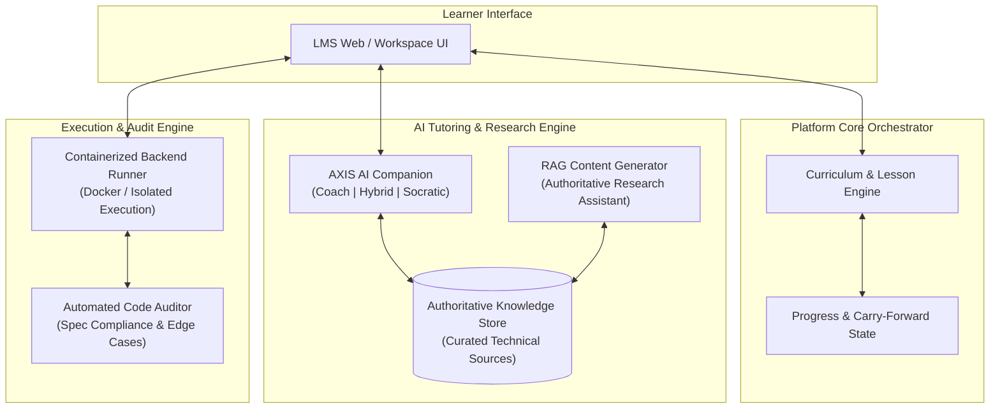

# Architecture Document 01: Problem Statement & System Boundaries

- **Status:** Approved (Inquiry Phase Complete)
- **Role:** Principal Systems Architect & Lead Educational Engineer
- **Domain:** AI-First Knowledge Management & Learning Platform (LMS / KMS)
- **Date:** 2026-10-29

---

## 1. Executive Summary

Traditional programming education was designed for an era where humans functioned as biological compilers—memorizing syntax, typing boilerplate, and grinding algorithmic puzzles disconnected from business reality.

In the AI era, LLMs synthesize raw syntax instantly. The true bottleneck has shifted from **typing code** to **systemic comprehension, specification formulation, and architectural verification**.

This platform is an industry-grade Knowledge Management and Learning Platform (LMS / KMS) designed to train non-traditional career switchers (social sector, policy, operations) and college students to become **Software Architects and AI Systems Directors**. Learners master systems design, data contracts, and AI engineering using a **Cumulative Project Spine** that grounds all programming concepts in real-world operational workflows.

### 1.1 Production-Grade & Dual-Purpose Mandate
This platform is deliberately architected for **real production deployment**, not as a throwaway tutorial demo:
- **Production Hardening (target state; see "Built Today vs Pluggable Seams" in ARCHITECTURE.md for what runs now):** Enforces hardened Docker sandbox execution with network and resource isolation, dual-store persistence (SQLite for development / PostgreSQL for production with atomic migrations), and a strict Two-Stage RAG Provenance Firewall.
- **Top-Tier Portfolio Asset:** By engineering for real multi-tenant reliability, FinOps token monitoring, and deterministic evidence auditing, the platform demonstrates the highest echelon of systems thinking and AI engineering.

---

## 2. Target Personas & Core Failure Modes

### 2.1 The Learner Archetypes
1. **The Non-Traditional Career Switcher:** Transitioning from domain-heavy backgrounds (e.g., social sector program managers, policy researchers, operational leads). They possess strong intuition for human processes, organizational hierarchies, and operational workflows, but lack traditional computer science syntax.
2. **The Modern College Student:** Seeks industry-relevant engineering capabilities rather than obsolete academic curricula, preparing to build software in an AI-assisted world.

### 2.2 Failure Modes of Existing LMSs
* **The Syntax-First Trap:** Spending weeks on abstract syntax (e.g., looping through `['apple', 'banana']`), causing cognitive fatigue before ever touching a real system architecture.
* **Toy Context Disconnect:** Disjointed assignments that reset context every chapter, failing to demonstrate how real enterprise codebases evolve.
* **The "Blind AI" Hallucination:** Relying on ungrounded chat models that hallucinate incorrect APIs and hand out copy-paste code without fostering critical thinking.
* **Passive Consumption:** Video-heavy lectures with superficial multiple-choice quizzes that fail to evaluate actual debugging, modification, and architectural defense skills.

---

## 3. Core Educational Philosophy & USP

### 3.1 Systems Thinking First: "The Communication Cycle"
Programming concepts are introduced not as mathematical abstractions, but as **operational communication cycles** that map directly to the learner's lived experience:
* `input()` $\rightarrow$ **Ingress / Intake:** Receiving data across a system boundary (e.g., citizen or beneficiary registration).
* `f-strings / formatting` $\rightarrow$ **Transformation & Packaging:** Structuring state and issuing formal receipts/acknowledgments.
* `print()` $\rightarrow$ **Egress / Output:** Delivering confirmation and dispatching feedback to external actors.

### 3.2 The Cumulative Project Spine
Every concept from day one accumulates into a single, cohesive, production-grade system:
$$\text{Single Intake Desk} \longrightarrow \text{Batch Validation} \longrightarrow \text{File/JSON Store} \longrightarrow \text{RAG Pipelines} \longrightarrow \text{Autonomous AI Agents}$$
The learner never asks *"Why am I learning this?"* Every lesson directly scales the preceding system state.

### 3.3 The "Fading Scaffolding" Model
To build both tactile confidence and architectural mastery:
* **Foundational Track (Python Core):** 100% manual code entry paired with automated **AI Code Reviews** to build syntactic muscle memory and edge-case intuition.
* **Advanced Track (AI Engineering):** Manual boilerplate typing fades; learners focus on writing **targeted logic snippets**, authoring **specifications (SPECs)**, designing **data contracts**, and orchestrating AI components.

---

## 4. System Boundaries & Core Subsystems

### 4.1 The Atomic Lesson Contract
Lessons are self-contained architectural nodes governed by a formal schema:
1. **Prerequisites:** Explicit prior concepts required for comprehension.
2. **Carry-Forward Data Context:** The exact state payload, data schema, or code artifact inherited from prior modules, allowing learners to jump into any lesson with instant contextual clarity.
3. **Concept Wiki Links:** Integrated references to standalone, canonical Concept Notes.
4. **Verification Criteria:** Deterministic tests and automated review rubrics.

### 4.2 AXIS AI (Pedagogical Companion)
* **Zero Hallucination Policy:** Grounded strictly via RAG against curated, authoritative technical documentation. No ungrounded self-generated answers.
* **Tri-Modal Pedagogical Operation:**
  1. **Coach Mode:** High guidance, actionable hints, supportive debugging.
  2. **Hybrid Mode:** Balanced conceptual answers while challenging the learner to draft the implementation.
  3. **Socratic Mode:** Inquiry-only. Guides the learner through probing questions without handing over direct solutions.

### 4.3 Content Generation Engine
A backend research assistant utilizing RAG over authoritative documentation to synthesize standardized lessons, verification checks, and real-world case study materials.

### 4.4 Execution Sandbox
* **Current Boundary:** Containerized backend execution environment (Docker-isolated runners) providing secure, reproducible code execution and automated testing.
* **Future Boundary:** Hybrid synchronization enabling learners to optionally code in local IDEs (VS Code/CLI) while syncing execution state and telemetry back to the platform.

---

## 5. Technical Constraints & Design Principles

1. **Inference Quality:** Cloud-hosted frontier models are utilized for RAG synthesis and AXIS AI interactions to guarantee pedagogical quality and technical precision.
2. **Strict Separation of Concerns:**
   * Platform Core (course progression, learner state) is strictly isolated from external AI vendor APIs.
   * AI interactions are encapsulated behind provider-agnostic interfaces supporting mock modes (`MOCK_AI=true`) for local, deterministic testing without API spend.
3. **Spec-Driven Governance:** Every architectural component must be preceded by an Architecture Decision Record (ADR) and formal Markdown specification before code synthesis.

---

## 6. Next Architectural Step

Transition to **Step 2: Specification (SPEC) Drafting**:
* Co-authoring the formal domain data models (`docs/specs/01-lesson-and-curriculum-spec.md`).
* Formulating the Data Contract for:
  * Lesson schema & Carry-forward state.
  * AXIS AI interaction payloads and mode transitions.
  * Container execution request/response envelope.
